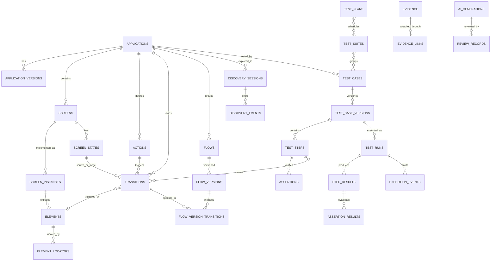

# Reverse Screen / Application Quality Platform — ERD v1.0

## Repository decision
- Phase 1: keep Wireflow Review and QA Platform in separate repositories.
- Define and publish versioned contracts for application-model, flow-model, test-model, and execution-contract.
- Phase 2: move the applications and shared packages into a Monorepo without changing domain identifiers or contracts.
- Do not make either product depend on the other's database schema. Both consume shared domain contracts/API.

## Logical ERD

## Entity responsibilities

| Aggregate | Entity | Responsibility |
|---|---|---|
| Application | Application | Product/system boundary |
| Application | Application Version | Build, release, commit and environment identity |
| Application | Execution Target | Browser/device/simulator configuration |
| Screen model | Screen | Platform-neutral logical screen |
| Screen model | Screen Instance | Platform-specific implementation of a logical screen |
| Screen model | Screen State | Meaningful UI state within a screen |
| UI model | Element | Semantic UI element on a screen instance |
| UI model | Element Locator | Platform/engine-specific way to find an element |
| Flow model | Action | Reusable action vocabulary |
| Flow model | Transition | Directed state-to-state behavior |
| Flow model | Flow / Flow Version | Curated, versioned path or graph |
| Discovery | Discovery Session | One runtime exploration attempt |
| Discovery | Discovery Event | Ordered observation/action event |
| QA | Test Case / Version | Test intent and immutable revisions |
| QA | Test Step | Executable instruction or checkpoint |
| QA | Assertion | Expected behavior/result |
| QA | Suite / Plan | Test organization and execution grouping |
| Execution | Test Run | One execution of a specific test version |
| Execution | Step Result | Attempt-level result for a step |
| Execution | Assertion Result | Actual vs expected evaluation |
| Evidence | Evidence | Blob metadata and storage location |
| Evidence | Evidence Link | Association to domain object |
| AI | Generation | AI input/output/model provenance |
| AI | Review Record | Human decision on generated output |

## Critical modeling rules
1. **Screen != Screen Instance != Screen State.** A logical Login screen can have Android, iOS and Web instances and multiple states such as Initial, Invalid Credentials and Loading.
2. **Flow != Test Case.** A Flow describes observed/possible product behavior. A Test Case describes a verification objective and may cover one or more transitions, or test behavior not represented as a UI transition.
3. **Discovery != Execution.** Discovery explores and proposes graph facts; Test Execution runs approved test definitions and records pass/fail evidence.
4. **Verified != Approved.** verified means runtime evidence supports a behavior. approved means a human has accepted a test/model artifact. They are different dimensions.
5. **Versioned artifacts are immutable after publication.** Edit by creating a new flow_version or test_case_version.
6. **Engine details stay in adapters.** Persist semantic actions, locator strategy/value, and normalized results—not Playwright or Mobilewright runtime objects.
7. **Evidence blobs live outside PostgreSQL.** Store object URI, hash, MIME type and metadata in PostgreSQL; store screenshot/video/trace bytes in S3-compatible storage.
8. **Hybrid navigation is explicit.** A WebView-to-native handoff is represented as a transition with platform scope and implementation metadata, not hidden inside a single Web screen.
9. **Coverage is derived.** Transition coverage is computed by linking Test Steps to Transitions and successful Step Results, not stored as a manually maintained counter.

## Status vocabularies
- Discovery status: inferred, discovered, verified, deprecated.
- Test review status: pending, approved, rejected, needs_changes.
- Test run status: queued, running, passed, failed, error, cancelled, skipped.
- AI generation status: queued, running, completed, failed.

## Repository boundary
During separate development:
- Wireflow Review owns its UI and imports/exports the shared Flow contract.
- QA Platform owns test authoring/execution and consumes Application/Flow contracts.
- A versioned OpenAPI/JSON Schema package is the integration boundary.
- Avoid cross-repository database writes. Use APIs or import/export events.
- When moving to Monorepo, retain package boundaries (apps/*, packages/*) and CI ownership.
